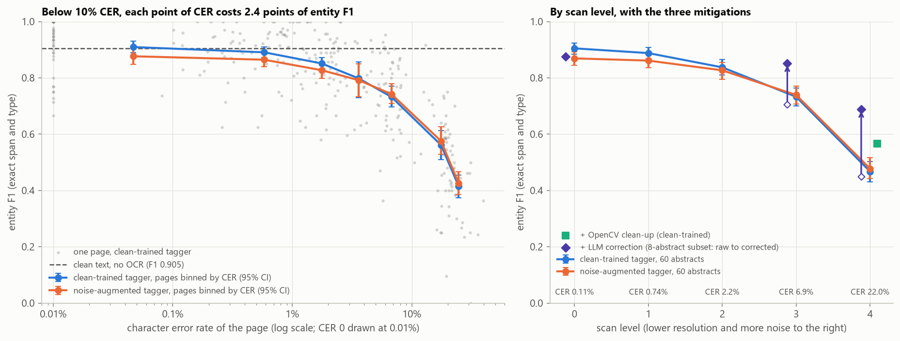
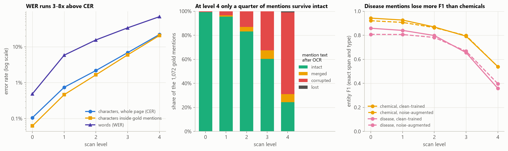
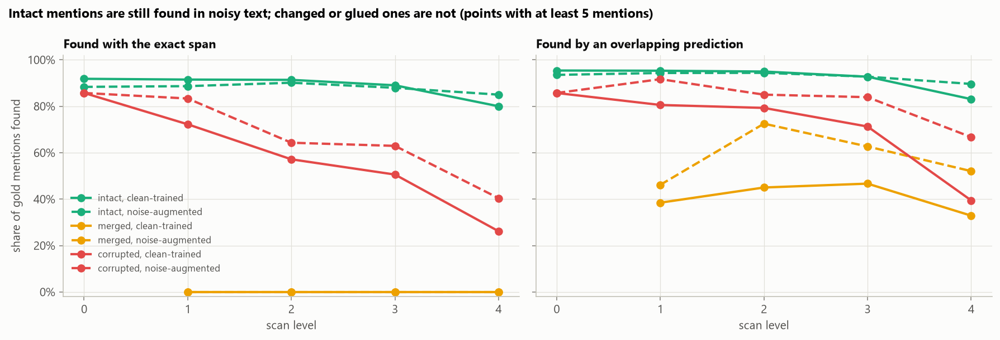
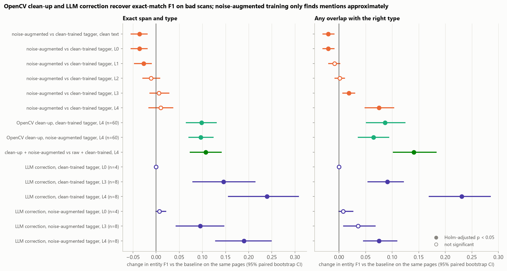
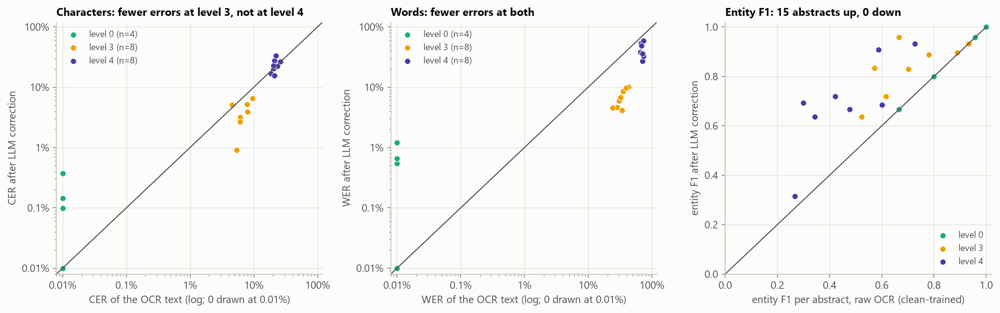
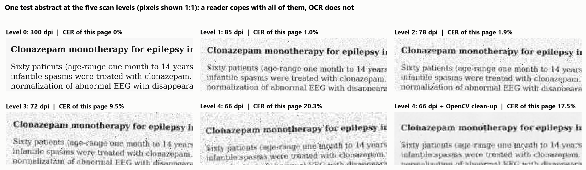

# How OCR Errors Break Clinical NER, and How to Fix It

[](https://github.com/ChetanYarlagadda/ocr-noise-clinical-ner/actions/workflows/ci.yml)

**How much entity-recognition accuracy does a biomedical NER model lose when its input comes from a scanner and an
OCR engine instead of clean text, and which fix gets the most of it back?** This project renders 60 BC5CDR test
abstracts as synthetic scanned pages at five degradation levels, reads them back with the docTR OCR models on a GPU,
projects every gold chemical and disease mention onto the OCR text through a character-level alignment, and scores a
PubMedBERT tagger fine-tuned on clean text. Three fixes are tested on the same pages: OpenCV clean-up of the page image,
fine-tuning on text corrupted by a noise model learned from real OCR errors, and post-correction of the OCR text by a
local LLM (qwen3:4b through Ollama).

It mirrors clinical document intelligence: referral letters, faxed lab reports and scanned discharge summaries pass
through OCR before a model extracts drugs and diagnoses. OCR vendors report character error rates; the question that
matters downstream is how many entities survive, which is what this project measures, with entity F1 plotted against
CER, 95% bootstrap confidence intervals over documents and paired tests for every fix.



## Key findings

| Input to the clean-trained tagger (60 test abstracts, 1,072 gold mentions) | CER | WER | Mentions intact | Entity F1, exact (95% CI) | Entity F1, overlap |
|---|---:|---:|---:|---:|---:|
| Clean text (no OCR) | 0 | 0 | 100% | 0.905 (0.884-0.923) | 0.939 |
| Level 0: clean 300 dpi scan | 0.11% | 0.49% | 99.3% | 0.905 (0.883-0.924) | 0.939 |
| Level 1: 85 dpi, light blur and noise | 0.74% | 5.8% | 95.4% | 0.888 (0.868-0.908) | 0.929 |
| Level 2: 78 dpi | 2.2% | 15.5% | 83.2% | 0.837 (0.811-0.865) | 0.911 |
| Level 3: 72 dpi | 6.9% | 33.8% | 60.4% | 0.733 (0.701-0.764) | 0.857 |
| Level 4: 66 dpi, heavy blur, noise and JPEG | 22.0% | 69.1% | 24.3% | 0.467 (0.430-0.503) | 0.611 |
| Level 4 + OpenCV clean-up (deskew, non-local-means denoising) | 15.6% | 60.5% | 29.9% | 0.566 (0.528-0.605) | 0.698 |
| Level 4 + clean-up + noise-augmented tagger | 15.6% | 60.5% | 29.9% | 0.574 (0.538-0.612) | 0.752 |

<sub>CER and WER are pooled edit distances over all pages of a level (characters or whitespace-separated words, divided
by the reference length). "Intact" means the mention's characters came through unchanged and still form a separate word.
Exact F1 needs the same start, end and type as the projected gold mention; overlap F1 accepts any overlapping prediction
of the right type. All rows: [`condition_summary.csv`](reports/results/condition_summary.csv).</sub>

1. **Entity F1 is flat on a clean scan and falls fast once characters go wrong.** A clean 300 dpi page costs nothing
   (CER 0.11%, F1 unchanged at 0.905). From there every point of CER costs about 2.4 points of exact-match F1 up to 10%
   CER (slope -0.024 per CER point, bootstrap CI -0.030 to -0.018): -1.7 points at 0.7% CER, -6.8 at 2.2%, -17.2 at
   6.9% and -43.8 at 22% (all Holm-adjusted p < 0.01).
2. **One wrong character breaks a whole word, and that is what hurts the tagger.** WER runs 3-8 times above CER, and at
   level 3 four mentions in ten are altered (32% have a changed character, 7% are glued to a neighbouring word by a
   lost space or hyphen). Mentions that come through intact are still found almost as often as on clean text (89%
   with the exact span at level 3, 80% at level 4, against 92%); corrupted ones are found 51% and 26% of the time, glued
   ones never with the exact span. Disease names, often several words long, lose more than chemical names (level 4 F1
   0.36 against 0.54).
3. **Cleaning the page image before OCR is the cheapest fix.** Deskewing plus non-local-means denoising, chosen on
   development pages, cuts the level-4 CER from 22.0% to 15.6% and lifts exact F1 from 0.467 to 0.566 (+9.8 points,
   paired CI +6.5 to +13.0, Holm p < 0.001). The textbook alternative, Otsu binarisation after median filtering, made the
   neural OCR worse on the development pages (CER 24.5% against 20.7% untouched).
4. **LLM post-correction recovers the most, even where it does not lower CER.** On an 8-abstract subset, qwen3:4b
   correction raises exact F1 from 0.706 to 0.851 at level 3 (+14.6 points, CI +8.0 to +21.4, Holm p < 0.001; CER
   6.4% to 2.9%) and from 0.449 to 0.689 at level 4 (+24.0, CI +15.7 to +30.7) although level-4 CER rises from 21.8%
   to 24.4%: the model restores words (WER 70% to 43%) and entity names (intact mentions 21% to 65%) while rewriting or
   dropping unreadable stretches. On four near-clean level-0 abstracts it changed 0.16% of characters and no mention.
   The subset is small, so the CIs are wide.
5. **Noise-augmented fine-tuning does not improve exact matches.** Training on a 50/50 mix of clean abstracts and
   copies corrupted by a noise channel learned from real OCR errors leaves exact F1 unchanged at levels 2-4 (-1.1 to
   +1.0 points, n.s.) and costs 3.6 points on clean text (Holm p < 0.001). It does find more damaged mentions: at
   level 4 it recovers 40% of corrupted mentions exactly (26% clean-trained) and 67% approximately (40%), so overlap F1
   rises by 7.5 points (Holm p < 0.001), at the price of more false positives (exact precision 0.47 against 0.63).
6. **The pipeline checks out.** The corpus matches the published article and mention counts (9 of 9), the
   concept-level scorer reproduces the precision, recall and F1 that the corpus authors report for their tmChem and
   DNorm outputs, the clean-text tagger lands near published PubMedBERT results on the full test set (chemicals 0.926
   against 0.933, diseases 0.838 against 0.856), and the span projection agrees with the known answer on 98.7% of
   mentions in synthetic corruptions.

## Results

### Entity F1 against character error rate

Every raw-OCR page (60 abstracts x 5 levels) is binned by its own CER
([`f1_vs_cer_bins.csv`](reports/results/f1_vs_cer_bins.csv); micro F1 within a bin, CI from resampling its pages):

| Page CER | Pages | Pooled CER | Exact F1 (95% CI), clean-trained | Exact F1, noise-augmented |
|---|---:|---:|---:|---:|
| < 0.25% | 53 | 0.05% | 0.909 (0.890-0.930) | 0.877 |
| 0.25-1% | 58 | 0.58% | 0.891 (0.871-0.910) | 0.864 |
| 1-2.5% | 58 | 1.8% | 0.851 (0.829-0.873) | 0.827 |
| 2.5-5% | 20 | 3.6% | 0.798 (0.730-0.857) | 0.791 |
| 5-10% | 46 | 6.8% | 0.732 (0.696-0.770) | 0.742 |
| 10-20% | 33 | 17.6% | 0.561 (0.509-0.612) | 0.575 |
| >= 20% | 32 | 24.7% | 0.415 (0.374-0.455) | 0.425 |

Precision falls more slowly than recall (at >= 20% CER: precision 0.58, recall 0.32 for the clean-trained tagger): the
tagger mostly misses mentions in damaged text rather than inventing them. The noise-augmented tagger starts lower and
crosses the clean-trained one at about 5% CER, but the two are never significantly apart on exact matches above that.

### What OCR does to the mentions



Characters inside mentions are corrupted slightly *less* often than the page average (level 4: 20.7% against 22.0%),
because the commonest OCR errors hit spaces, full stops, commas and hyphens
([`noise_channel.csv`](reports/results/noise_channel.csv): a lost space is the single most frequent error, 4.3% of all
spaces on the development pages, and 19% of full stops and hyphens disappear). Every such error still breaks a word,
which is why WER and the share of altered mentions grow much faster than CER.



Splitting the gold mentions by their fate separates two effects ([`mention_status.csv`](reports/results/mention_status.csv)):
*context damage* is small (an intact mention is found exactly 89% of the time at level 3 and 80% at level 4, against
92% on clean text), while *direct damage* dominates (a corrupted mention is found exactly 51% and 26% of the time, and a
mention glued to its neighbour can never be matched exactly by a word-level tagger, though 33-47% are found
approximately). Lost mentions, whose characters were all deleted, are rare (0.8% at level 4).

### The three fixes



Paired bootstrap over abstracts (1,000 resamples, Holm correction over the 20 exact-match comparisons and separately
over the 20 overlap comparisons; [`significance.csv`](reports/results/significance.csv)):

| Fix vs baseline on the same pages | Level | n | Exact F1 change (95% CI) | Holm p | Overlap F1 change | Holm p |
|---|---|---:|---:|---:|---:|---:|
| OpenCV clean-up, clean-trained tagger | 4 | 60 | **+0.098** (+0.065 to +0.130) | <0.001 | **+0.087** | <0.001 |
| OpenCV clean-up, noise-augmented tagger | 4 | 60 | **+0.097** (+0.071 to +0.123) | <0.001 | **+0.065** | <0.001 |
| Clean-up + noise-augmented vs raw + clean-trained | 4 | 60 | **+0.107** (+0.074 to +0.141) | <0.001 | **+0.141** | <0.001 |
| Noise-augmented vs clean-trained tagger | clean text | 60 | **-0.036** (-0.054 to -0.019) | <0.001 | **-0.020** | 0.002 |
| | 1 | 60 | **-0.027** (-0.047 to -0.010) | 0.023 | -0.008 | 0.47 |
| | 2 | 60 | -0.011 (-0.028 to +0.008) | 1.00 | +0.002 | 1.00 |
| | 3 | 60 | +0.006 (-0.013 to +0.028) | 1.00 | **+0.019** | 0.018 |
| | 4 | 60 | +0.010 (-0.015 to +0.036) | 1.00 | **+0.075** | <0.001 |
| LLM correction, clean-trained tagger | 0 | 4 | 0.000 | 1.00 | 0.000 | 1.00 |
| | 3 | 8 | **+0.146** (+0.080 to +0.214) | <0.001 | **+0.091** | <0.001 |
| | 4 | 8 | **+0.240** (+0.157 to +0.307) | <0.001 | **+0.231** | <0.001 |
| LLM correction, noise-augmented tagger | 3 | 8 | **+0.096** (+0.043 to +0.146) | 0.002 | +0.036 | 0.12 |
| | 4 | 8 | **+0.190** (+0.129 to +0.248) | <0.001 | **+0.075** | <0.001 |

<sub>Bold: Holm-adjusted p < 0.05. Level 0 + LLM for the noise-augmented tagger (+0.007) is omitted from the table and
not significant.</sub>

**Page clean-up.** Three OpenCV pipelines were compared on four development abstracts at level 4
([`preprocessing_selection.csv`](reports/results/preprocessing_selection.csv)): deskew alone (CER 16.5% against 20.7%
untouched), deskew + non-local-means denoising (14.9%, chosen) and deskew + 2x upscaling + median filter + Otsu
binarisation (24.5%, worse than nothing). On the 60 test pages the chosen pipeline lowers CER from 22.0% to 15.6%.
Deskewing alone gives most of the gain on the development pages; on tilted pages docTR's line grouping can interleave
words from adjacent lines, which a probe with stronger skew showed clearly.

**Noise-augmented fine-tuning.** The noise channel is learned from the OCR output of six development abstracts at
levels 1-4: per-character deletion and substitution rates, and insertion rates, from the minimum-edit alignment
(expected CER 7.9% at scale 1). In every epoch half of the 500 training abstracts are replaced by a fresh noisy copy at
a CER drawn log-uniformly between 0.5% and 25%, so both taggers take the same number of optimisation steps. The
augmented tagger learns to tag damaged words (more corrupted mentions found, overlap F1 up) but not where a damaged
mention starts and ends, and it loses precision on clean text. The epoch kept for each tagger is the one with the best
F1 on clean development abstracts, which picked epoch 1 of 2 for the augmented tagger (dev F1 0.869, against 0.884 for
the clean-trained tagger at epoch 2); see the limitations.

### LLM post-correction



| Subset ([`llm_summary.csv`](reports/results/llm_summary.csv)) | CER | WER | Mentions intact | Exact F1, clean-trained | Exact F1, noise-augmented |
|---|---:|---:|---:|---:|---:|
| Level 3, 8 abstracts: raw OCR | 6.4% | 33.0% | 52.9% | 0.706 | 0.734 |
| Level 3: LLM-corrected | 2.9% | 6.5% | 90.8% | 0.851 | 0.829 |
| Level 4, 8 abstracts: raw OCR | 21.8% | 70.2% | 21.0% | 0.449 | 0.477 |
| Level 4: LLM-corrected | 24.4% | 42.5% | 64.7% | 0.689 | 0.667 |
| Level 0, 4 abstracts: raw OCR | 0.00% | 0.00% | 100% | 0.876 | 0.862 |
| Level 0: LLM-corrected | 0.16% | 0.64% | 100% | 0.876 | 0.869 |

Exact F1 rose on 15 of the 20 corrected abstracts and fell on none ([`llm_correction.csv`](reports/results/llm_correction.csv)).
At level 4, CER went up on 4 of 8 abstracts: the model shortened one abstract by 9% and rewrote passages it could not
read, yet the drug and disease names it restored were enough for the tagger. Corrected text also helps the clean-trained
tagger more than the noise-augmented one, so the two fixes do not add up. Each call took 2-10 s on the laptop GPU
(about 5 s per abstract), which is the main practical cost.

### Clean-text check against published results

[`published_comparison.csv`](reports/results/published_comparison.csv), all 500 BC5CDR test abstracts, exact-match F1:

| System | Chemicals | Diseases |
|---|---:|---:|
| PubMedBERT fine-tuned here (one model for both types, 2 epochs), clean-trained | 0.926 (0.914-0.936) | 0.838 (0.820-0.854) |
| Same, noise-augmented | 0.922 | 0.811 |
| PubMedBERT, Gu et al. (2021), Table 6 (separate model per type) | 0.933 | 0.856 |
| BioBERT, Gu et al. (2021), Table 6 | 0.929 | 0.847 |
| tmChem / DNorm outputs shipped with the corpus, scored here | 0.898 | 0.800 |
| Inter-annotator agreement of the corpus, test set (Li et al., 2016) | 0.963 | 0.888 |

The clean-trained tagger is 0.7 and 1.9 points below the published PubMedBERT results, which trained one model per
entity type with tuned hyperparameters; two epochs and a single joint model are enough for this study, whose questions
are about relative losses. The concept-level scorer reproduces the corpus README's figures for the tmChem output
(P/R/F 0.925/0.899/0.912 against 0.92/0.90/0.91) and the DNorm output (0.810/0.802/0.806 against 0.81/0.80/0.81),
[`scorer_check.csv`](reports/results/scorer_check.csv).



## Data

| | |
|---|---|
| Source | BioCreative V CDR corpus (BC5CDR), `CDR_Data.zip` (20 MB) from the BigBio mirror on the Hugging Face Hub, pinned to commit `6ba1463` and SHA-256 `0a359a7f...`; downloaded once into `data/raw/` (git-ignored) |
| Content | 1,500 PubMed titles and abstracts (500 train / 500 development / 500 test) with every chemical and disease mention annotated as a character span; 5,203 / 5,347 / 5,385 chemical and 4,182 / 4,244 / 4,424 disease mentions, matching Table 1 of Li et al. (2016) ([`data_crosscheck.csv`](reports/results/data_crosscheck.csv)) |
| Use here | Tagger: trained on the 500 training abstracts, epoch chosen on 150 development abstracts. Scanned pages: 60 test abstracts drawn at random (seed 0) with 1,072 mentions (596 chemical, 476 disease). Noise channel and page clean-up chosen on separate development abstracts. Clean-text benchmark: all 500 test abstracts |
| Licence | Public domain: the archive's NCBI notice declares it a United States Government Work freely available to the public, asking users to cite the corpus papers (cited below). The abstracts come from PubMed; one abstract appears in figure 00 and as a 600-character excerpt in `examples.csv` for illustration |

99.95% of the test mentions start and end on word boundaries of the tagger's tokenisation, so word-level tagging can
match nearly all of them exactly on clean text ([`split_summary.csv`](reports/results/split_summary.csv)).

## Method

**Synthetic scans.** Each abstract is typeset with Pillow at 300 dpi (DejaVu Serif, the font bundled with matplotlib;
12 pt bold title, 11 pt body, 6.5 inch text width, no hyphenation) and passed through a scanner model
([`degradation_levels.csv`](reports/results/degradation_levels.csv)): rotation by 0.5-1 times the level's maximum skew
(0.8-1.5 degrees, random sign), Gaussian blur (1.6-2.2 px at 300 dpi), box down-sampling to the scan resolution (85, 78,
72 and 66 dpi), Gaussian sensor noise (16-24 grey levels), salt-and-pepper speckle (0.1-0.3% of pixels) and JPEG
compression (quality 50-30). Level 0 is the undegraded 300 dpi page. The ladder was set on development abstracts so
that the mean CER roughly triples from one level to the next above level 1; every page is seeded by its PubMed ID and
level.

**OCR.** docTR 1.1 with its pretrained DBNet (ResNet-50) text detector and CRNN (VGG-16) recogniser, on the GPU in
fp32, `assume_straight_pages=True`. A probe in half precision broke recognition (41% CER on clean pages), so fp32 is
used. The page text is docTR's reading-order rendering with whitespace collapsed; the reference is the PubTator text
(title + space + abstract) with whitespace collapsed.

**Alignment and span projection.** CER and WER are Levenshtein distances (RapidFuzz, checked against a plain
dynamic-programming implementation) divided by the reference length. Gold spans are projected through the
minimum-edit alignment: each reference character is either kept (matched or substituted) or deleted; a mention maps to
the span from its first to its last kept character, so characters the OCR inserted inside a mention belong to it and
those at its edges do not; edge whitespace is trimmed; a mention with every character deleted is *lost* and counts as a
false negative for every system. The rule is unit-tested on constructed corruptions with known answers and on random
corruptions from the noise generator, which tracks the true positions: projection and generator agree on 100%, 99.3%
and 96.8% of mentions at 1%, 5% and 20% CER ([`channel_check.csv`](reports/results/channel_check.csv)); the
disagreements are ties in the alignment next to a mention edge.

**Tagger.** `microsoft/BiomedNLP-BiomedBERT-base-uncased-abstract` (PubMedBERT, 109 M parameters, MIT licence) with a
token-classification head over BIO labels for both types. Text is split into words with `\w+|[^\w\s]`, cut into windows
of at most 80 words (preferably after a full stop, so OCR text is windowed the same way), and each word is labelled by
its first sub-word (max length 256). AdamW (learning rate 5e-5, weight decay 0.01, 10% warm-up then linear decay),
batch 16, 2 epochs in bfloat16 autocast, keeping the epoch with the best exact-match F1 on 150 clean development
abstracts. Predicted mentions are runs of B- and I- labels of one type mapped back to character offsets.

**Fixes.** (1) OpenCV clean-up before OCR: projection-profile deskew (search over plus or minus 4 degrees in 0.1 degree
steps) and `fastNlMeansDenoising` (h = 15), chosen over two alternatives on development pages and applied to the level-4
test pages. (2) Noise-augmented fine-tuning as described above. (3) LLM post-correction: Ollama `qwen3:4b` (Q4_K_M) with
a system prompt asking it to fix OCR errors without paraphrasing, greedy decoding, the reply constrained to a JSON schema
`{"corrected_text": ...}`. That build is a thinking model whose template always opens a reasoning block; with
`think: false` and free-form output it wrote its reasoning into the answer, while the schema makes it answer directly.
Every reply is cached in SQLite under a hash of the full request.

**Metrics and statistics.** Micro-averaged precision, recall and F1 over mentions, with exact matching (same span and
type) and overlap matching (one-to-one, same type, at least one shared character). 95% CIs from 1,000 bootstrap
resamples of abstracts; paired comparisons resample the same abstracts for both systems, with p-values from the
bootstrap standard error and Holm correction within each metric. The F1-per-CER slope is a least-squares fit of
per-page F1 on CER for the 235 raw-OCR pages below 10% CER, with a bootstrap CI over pages.

**Tracking.** Every condition is logged to a local MLflow store (`mlruns/`, git-ignored); run times are appended to
[`compute_log.csv`](reports/results/compute_log.csv).

## Validation and limitations

- **Synthetic scans, one font, one OCR engine.** Rendered pages with a simple scanner model are cleaner and more uniform
  than real faxes and photocopies (no handwriting, stamps, tables, columns, bleed-through or curved pages), and one
  serif font at one size was used. Other OCR engines (Tesseract, cloud OCR) fail differently; the CER-F1 relation is
  likely more portable than the per-level numbers.
- **Small samples for the expensive parts.** To stay within a small GPU budget, 60 test abstracts were scanned (not
  100-150), page clean-up was chosen on 4 development abstracts and applied at level 4 only, and the LLM corrected only
  8 abstracts at levels 3 and 4 and 4 at level 0. The LLM CIs are wide, and the level-0 check cannot rule out rare
  damage to clean text.
- **Abstracts, not clinical notes.** BC5CDR is PubMed literature; clinical documents have more abbreviations,
  templated sections and numbers, which OCR errors may affect differently.
- **One configuration of noise augmentation.** A single setting was tried (half of the documents, CER 0.5-25%, a
  unigram character channel learned from 6 development abstracts). Real OCR errors are bursty (whole lines merge or go
  missing) and the channel does not reproduce line-order mix-ups. Epoch selection on clean development text favours
  the clean-trained tagger and kept epoch 1 of the augmented one; selecting on noisy development text, other noise
  mixes, or character-aware models may do better.
- **Short fine-tuning.** Two epochs and one joint model for both entity types leave the clean-text tagger 0.7-1.9
  points below published PubMedBERT results; a stronger tagger would shift the curves up but probably not their shape.
  PubMedBERT was pretrained on PubMed text, which may include these abstracts (without labels).
- **The span-projection convention matters for exact F1.** Characters inserted at a mention's edge are excluded, glued
  words can never match exactly, and edits next to a mention edge can make the alignment ambiguous (about 3% of
  mentions at 20% CER). Overlap F1 is reported alongside to show how much of the loss is about boundaries.
- **CER of LLM output is not comparable to OCR CER.** The model can rewrite or drop text it cannot read, which raises
  CER while helping the tagger; it could also insert plausible but wrong drug names, which this small sample cannot
  quantify.
- **Not a medical device.** Research data and models, for methodological comparison only.

## Reproduce

```bash
pip install torch torchvision --index-url https://download.pytorch.org/whl/cu128   # or the CPU build
pip install -r requirements.txt
ollama pull qwen3:4b                      # local LLM for the post-correction step (Ollama at localhost:11434)
python scripts/run_pipeline.py            # full run: about 6 minutes on a laptop RTX 4050 (2 CPU threads)
python scripts/run_pipeline.py --quick    # smoke test on 4 abstracts with tiny budgets; outputs go to data/cache/smoke/
python scripts/make_figures.py            # redraw figures from reports/results/
pytest
```

The full run downloads the 20 MB corpus, the PubMedBERT weights (440 MB) and the docTR weights (165 MB) once. OCR text
of every page, trained weights, predictions and LLM replies are cached in `data/cache/` under keys that include every
setting that changes them, so a re-run recomputes only what changed (a fully cached run takes about 20 seconds). The one
full run took 5.7 minutes: OCR of 354 new pages 2.6 min, fine-tuning both taggers 1.3 min, 15 new LLM calls 1.3 min
(5 more came from the smoke run's cache) and inference 0.2 min.

## Project structure

```
ocrner/
  data.py         pinned BC5CDR download + SHA-256, PubTator parsing, checks against Li et al. (2016), concept scorer
  render.py       page typesetting and the five-level scanner model
  ocr.py          docTR predictor and the keyed OCR-text cache
  preprocess.py   OpenCV deskew, upscaling, median, non-local-means and Otsu steps
  align.py        Levenshtein, CER/WER, character alignment and span projection
  noise.py        OCR noise channel learned from alignments; sampling noisy copies with exact span tracking
  ner.py          word windows, BIO labels, PubMedBERT fine-tuning and prediction
  llm.py          Ollama post-correction with a JSON schema and a SQLite reply cache
  evaluate.py     mention fates, per-document counts, condition summaries
  metrics.py      exact/overlap matching, micro P/R/F1, bootstrap, paired differences, Holm
  figures.py      all report figures; plotting.py shared colorblind-safe styling; tracking.py MLflow logging
scripts/          run_pipeline.py (every experiment), make_figures.py
notebooks/        analysis.ipynb, the walkthrough with every table
reports/          figures/ and results/ (every number quoted above)
tests/            pytest suite (alignment and projection on known corruptions, scoring, BIO/windows, parsing, rendering, deskew)
.github/workflows/ CI: pyflakes and the pytest suite on CPU-only PyTorch (synthetic text and pages, no corpus or model download)
```

## License and citations

Code: MIT; see [LICENSE](LICENSE). Data: BC5CDR, public domain (NCBI notice), not redistributed except for the one
illustrative abstract noted above. Models: PubMedBERT (MIT), docTR and its pretrained weights (Apache-2.0), Qwen3
(Apache-2.0). Font: DejaVu (Bitstream Vera licence), as bundled with matplotlib.

- Li, J., Sun, Y., Johnson, R.J., Sciaky, D., Wei, C.-H., Leaman, R., Davis, A.P., Mattingly, C.J., Wiegers, T.C. and
  Lu, Z. (2016). BioCreative V CDR task corpus: a resource for chemical disease relation extraction. *Database* 2016,
  baw068.
- Wei, C.-H., Peng, Y., Leaman, R., Davis, A.P., Mattingly, C.J., Li, J., Wiegers, T.C. and Lu, Z. (2015). Overview of
  the BioCreative V Chemical Disease Relation (CDR) task. *Proceedings of the Fifth BioCreative Challenge Evaluation
  Workshop*, 154-166.
- Leaman, R., Dogan, R.I. and Lu, Z. (2013). DNorm: disease name normalization with pairwise learning to rank.
  *Bioinformatics* 29(22), 2909-2917. Leaman, R., Wei, C.-H. and Lu, Z. (2015). tmChem: a high performance approach
  for chemical named entity recognition and normalization. *Journal of Cheminformatics* 7, S3.
- Gu, Y., Tinn, R., Cheng, H., Lucas, M., Usuyama, N., Liu, X., Naumann, T., Gao, J. and Poon, H. (2021).
  Domain-specific language model pretraining for biomedical natural language processing. *ACM Transactions on
  Computing for Healthcare* 3(1), 2.
- Mindee (2021). docTR: Document Text Recognition. https://github.com/mindee/doctr
- Methods: Liao et al. (2020), DBNet text detection; Shi, Bai and Yao (2017), CRNN text recognition; Buades, Coll and
  Morel (2005), non-local-means denoising; Otsu (1979), threshold selection; van Strien et al. (2020), assessing the
  impact of OCR quality on downstream NLP tasks; Qwen team (2025), Qwen3.
